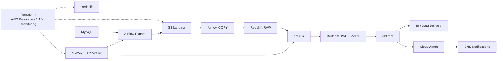
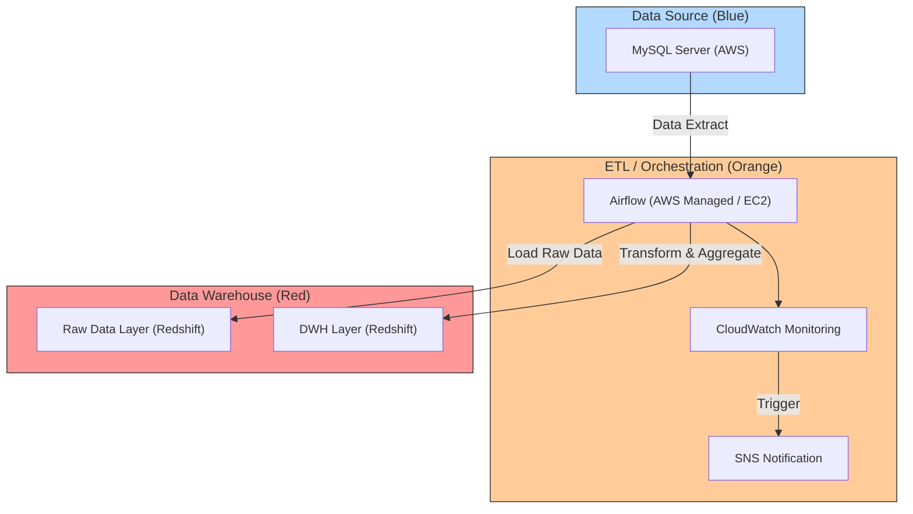

# AWS-DWH-Platform

[English](README.md) | [日本語](README.ja.md) | [简体中文](README.zh-CN.md)

図のラベルは、すべての言語版で英語に統一しています。

## Terraform・dbt・Airflowの追加設計案

このリポジトリはアーキテクチャのイメージ資料であり、以下は実装コードではなく、既存設計をIaCとSQL管理へ拡張する場合の配置案である。

### 追加位置と役割

| 追加要素 | 既存設計上の追加位置 | 管理対象・役割 | 期待効果 |
|---|---|---|---|
| Terraform | AWS基盤全体の外側に配置 | VPC、S3、Redshift、MWAAまたはEC2 Airflow、IAM、CloudWatch、SNSを環境単位で定義 | 環境構築の再現性、設定変更のレビュー、障害時の復旧性を向上し、手動設定漏れを削減 |
| dbt | RedshiftのRaw Data LayerとDWH Layerの間に配置 | Rawをsourceとして定義し、整形、結合、集計、データマートをSQLモデルとして管理 | SQLの依存関係、テスト、ドキュメント、変更履歴を一元管理し、DAG内SQLの肥大化を防止 |
| Airflow | 既存のETL / Orchestration層を拡張 | MySQL取込、Rawロード、dbt実行、品質テスト、DWH公開、CloudWatch/SNS通知をDAGで制御 | 各処理の順序、再実行、リトライ、失敗通知、実行履歴を統合管理 |

### 推奨する処理フロー



Airflowはデータ抽出・ロードと処理順序を担当し、Redshift内部のSQL変換はdbtへ集約する。ELTとして役割を分離することで、SQL変更時にDAG本体を修正する範囲を小さくできる。

### 想定する管理構成

```text
terraform/
  modules/              # Network、S3、Redshift、Airflow、IAM、監視
  environments/         # dev / stg / prodの環境差分
dbt/
  models/staging/       # RAWからの型変換、重複排除、命名統一
  models/intermediate/  # 共通ロジック、複数テーブルの結合
  models/marts/         # DWH・BI向け集計テーブル
  tests/                # データ品質と業務ルール
airflow/
  dags/                 # Extract、Load、dbt、公開、通知の依存関係
```

### 導入時の考慮事項

- Terraform stateは暗号化したS3とDynamoDB Lockで環境別に管理し、CI/CDでplanをレビューする。
- Redshift、S3、Airflow間はIAM Roleで接続し、アクセスキーやDBパスワードの直接配置を避ける。
- dbt実行用RoleはRAW参照と変換先Schema更新に限定し、BIユーザーは参照専用に分離する。
- AirflowではMySQL抽出、S3配置、Redshift COPY、dbt変換、dbt testを個別Taskとして再実行可能にする。
- dbt test失敗時は後続の公開処理を停止し、CloudWatchからSNSへテーブル名、実行ID、失敗種別を通知する。
- RedshiftのWLM、分散キー・ソートキー、dbtのincremental modelをデータ量に応じて設計し、実行時間とコストを抑える。

## 現状アーキテクチャ


