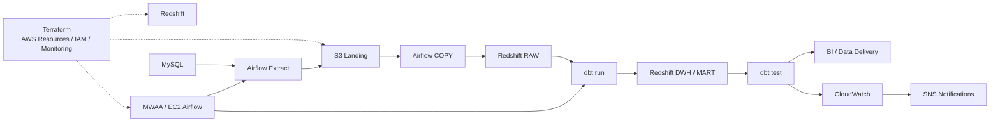
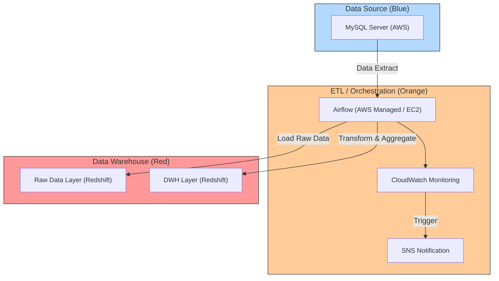

# AWS-DWH-Platform

[English](README.md) | [日本語](README.ja.md) | [简体中文](README.zh-CN.md)

Diagrams use English labels in all language versions.

## Proposed Terraform, dbt, and Airflow Extensions

This repository contains an architectural illustration. The following proposal extends the existing design with infrastructure as code (IaC) and SQL model management; it does not contain implementation code.

### Placement and Responsibilities

| Addition | Placement in the Existing Design | Resources / Responsibilities | Expected Benefits |
|---|---|---|---|
| Terraform | Encompasses the AWS infrastructure | Defines VPC, S3, Redshift, MWAA or Airflow on EC2, IAM, CloudWatch, and SNS per environment | Reproducible environments, reviewed configuration changes, easier recovery, and fewer manual configuration omissions |
| dbt | Between the Redshift Raw Data Layer and DWH Layer | Defines raw data as sources and manages cleaning, joins, aggregation, and data marts as SQL models | Centralizes SQL dependencies, tests, documentation, and change history while keeping SQL out of large DAGs |
| Airflow | Extends the existing ETL / Orchestration layer | Controls MySQL ingestion, raw loads, dbt execution, quality tests, DWH publication, and CloudWatch/SNS notifications through DAGs | Centralizes ordering, reruns, retries, failure notifications, and execution history |

### Recommended Processing Flow



Airflow handles extraction, loading, and execution order. dbt owns SQL transformations within Redshift. This ELT separation reduces the DAG changes required when SQL changes.

### Proposed Source Layout

```text
terraform/
  modules/              # Network, S3, Redshift, Airflow, IAM, monitoring
  environments/         # Environment differences: dev / stg / prod
dbt/
  models/staging/       # RAW type conversion, deduplication, consistent naming
  models/intermediate/  # Shared logic and multi-table joins
  models/marts/         # Aggregate tables for DWH / BI
  tests/                # Data quality and business rules
airflow/
  dags/                 # Extract, load, dbt, publication, notification dependencies
```

### Adoption Considerations

- Manage Terraform state per environment using encrypted S3 and DynamoDB locking, and review plans in CI/CD.
- Connect Redshift, S3, and Airflow using IAM roles instead of embedding access keys or database passwords.
- Limit the dbt execution role to reading RAW and updating target schemas; give BI users read-only access.
- Make MySQL extraction, S3 upload, Redshift COPY, dbt transformation, and dbt test separate, rerunnable Airflow tasks.
- Stop downstream publication when dbt tests fail, and send table names, run IDs, and failure types from CloudWatch to SNS.
- Choose Redshift WLM settings, distribution/sort keys, and dbt incremental models for the data volume to control runtime and cost.

## Current Architecture


