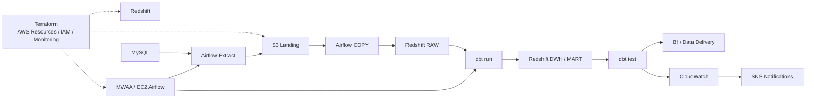
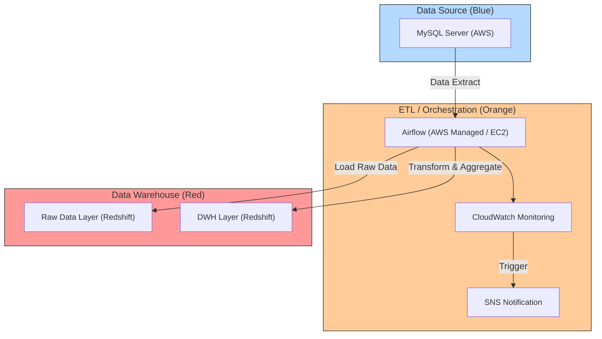

# AWS-DWH-Platform

[English](README.md) | [日本語](README.ja.md) | [简体中文](README.zh-CN.md)

所有语言版本的图表均使用英文标签。

## Terraform、dbt 与 Airflow 扩展设计方案

本仓库提供架构示意资料。以下内容是通过基础设施即代码（IaC）与 SQL 模型管理扩展现有设计的方案，不包含实现代码。

### 部署位置与职责

| 新增组件 | 在现有设计中的位置 | 管理对象与职责 | 预期效果 |
|---|---|---|---|
| Terraform | 覆盖整个 AWS 基础设施 | 按环境定义 VPC、S3、Redshift、MWAA 或 EC2 上的 Airflow、IAM、CloudWatch、SNS | 提高环境的可复现性、配置变更的可审查性与故障恢复能力，减少手动配置遗漏 |
| dbt | 位于 Redshift 的 Raw Data Layer 与 DWH Layer 之间 | 将原始数据定义为 source，以 SQL 模型管理清洗、关联、聚合与数据集市 | 统一管理 SQL 依赖、测试、文档与变更历史，避免 DAG 内 SQL 过度膨胀 |
| Airflow | 扩展现有 ETL / Orchestration 层 | 通过 DAG 控制 MySQL 采集、原始数据加载、dbt 执行、质量测试、DWH 发布与 CloudWatch/SNS 通知 | 统一管理执行顺序、重跑、重试、失败通知与执行历史 |

### 推荐处理流程



Airflow 负责数据抽取、加载与执行顺序，Redshift 内部的 SQL 转换由 dbt 集中管理。通过 ELT 职责分离，减少 SQL 变更时需要修改的 DAG 代码。

### 预期代码管理结构

```text
terraform/
  modules/              # 网络、S3、Redshift、Airflow、IAM、监控
  environments/         # dev / stg / prod 的环境差异
dbt/
  models/staging/       # RAW 类型转换、去重、统一命名
  models/intermediate/  # 公共逻辑、多表关联
  models/marts/         # 面向 DWH / BI 的聚合表
  tests/                # 数据质量与业务规则
airflow/
  dags/                 # 抽取、加载、dbt、发布与通知的依赖关系
```

### 引入时的注意事项

- 按环境使用加密 S3 与 DynamoDB 锁管理 Terraform state，并在 CI/CD 中审查 plan。
- Redshift、S3 与 Airflow 之间使用 IAM Role 连接，避免直接存放访问密钥或数据库密码。
- dbt 执行角色仅允许读取 RAW 与更新目标 Schema；BI 用户使用独立的只读权限。
- 将 MySQL 抽取、S3 上传、Redshift COPY、dbt 转换与 dbt test 拆分为可单独重跑的 Airflow Task。
- dbt test 失败时停止后续发布，通过 CloudWatch 向 SNS 发送表名、执行 ID 与失败类型。
- 根据数据量设计 Redshift WLM、分布键、排序键及 dbt incremental model，控制运行时间与成本。

## 当前架构


